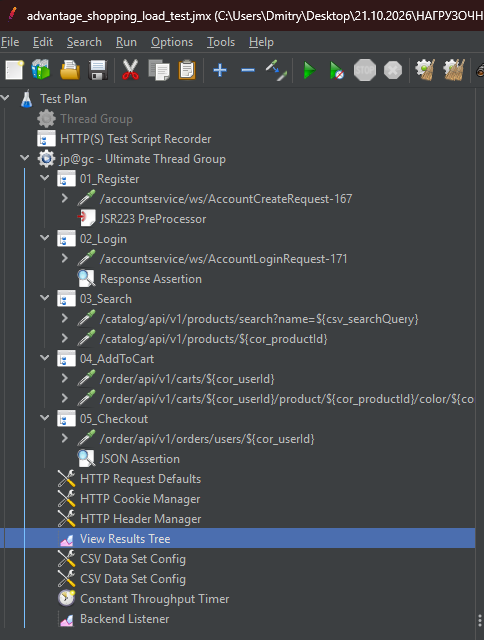
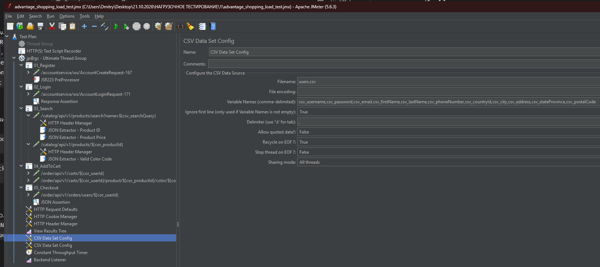
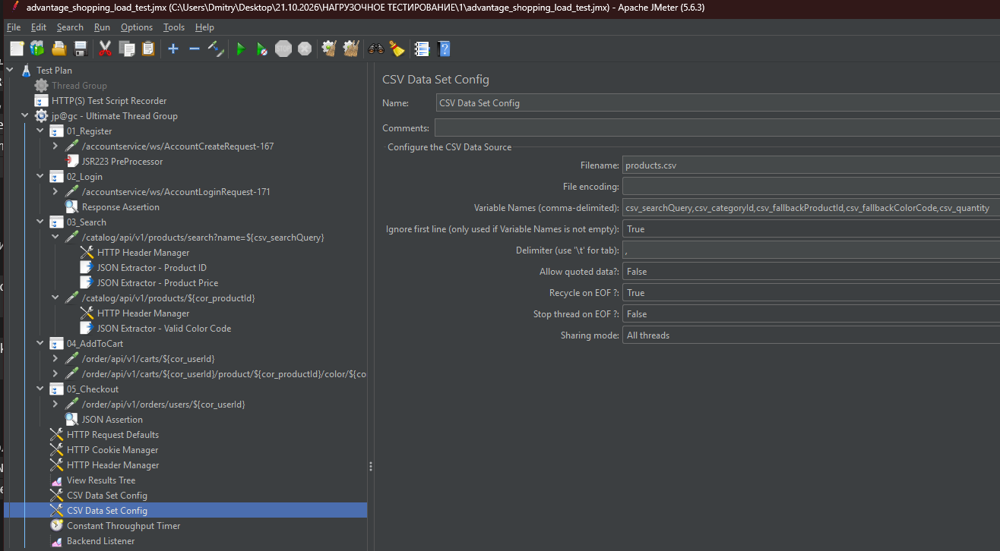
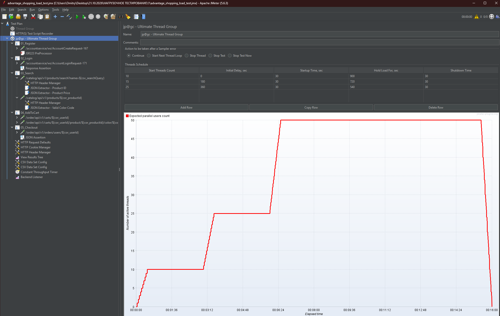
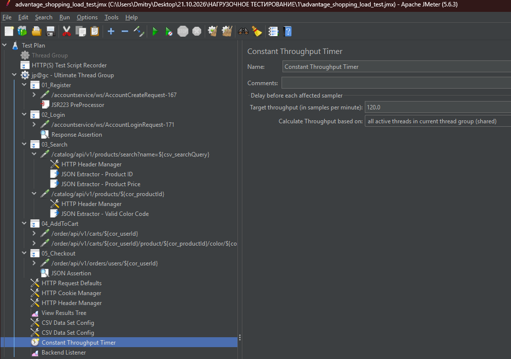
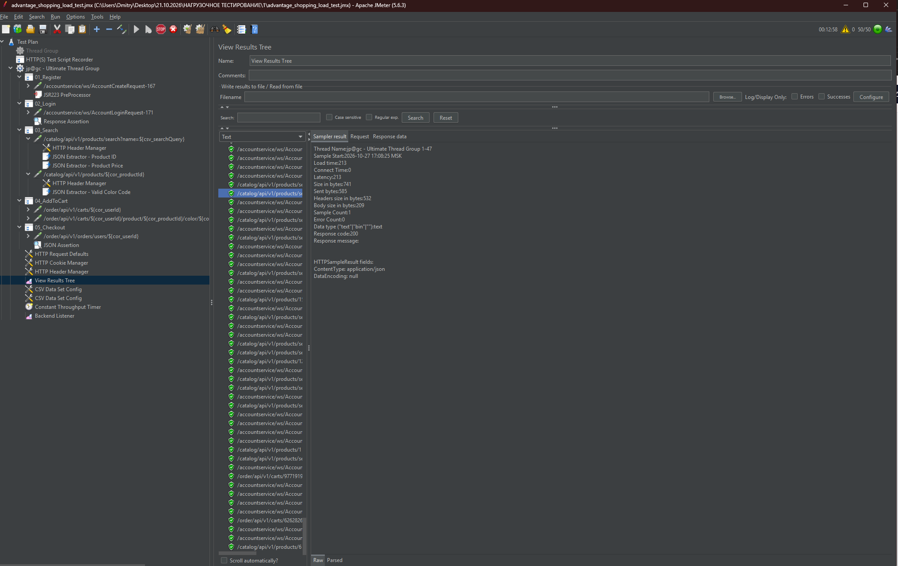
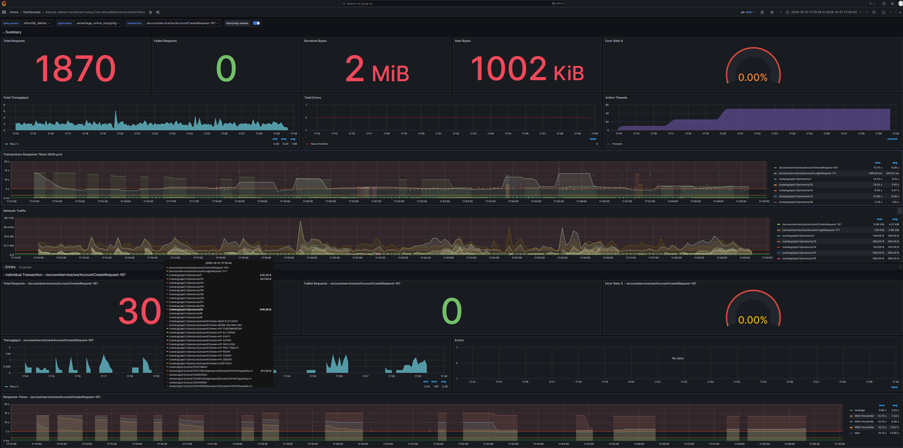

# Нагрузочное тестирование Advantage Online Shopping (Apache JMeter 5.6.3)


Репозиторий содержит тестовый план Apache JMeter для демонстрационного интернет-магазина [Advantage Online Shopping](https://www.advantageonlineshopping.com/), входные данные CSV, сохранённые результаты одного прогона и конфигурацию мониторинга InfluxDB + Grafana.

> **Важно:** описанные ниже настройки сверены с файлами, находящимися в этом репозитории. Сохранённые `results/` — это результаты уже выполненного прогона, а не гарантия того, что любой изменённый вариант `.jmx` был повторно запущен.

## Содержание

- [Сценарий пользовательского потока](#сценарий-пользовательского-потока)
- [Корреляция](#корреляция)
- [Параметризация CSV](#параметризация-csv)
- [Профиль нагрузки](#профиль-нагрузки)
- [Пэйсинг](#пэйсинг)
- [Проверки ответов (Assertions)](#проверки-ответов-assertions)
- [Мониторинг InfluxDB и Grafana](#мониторинг-influxdb-и-grafana)
- [Результаты сохранённого прогона](#результаты-сохранённого-прогона)
- [Структура репозитория](#структура-репозитория)
- [Запуск](#запуск)
- [Ограничения перед повторным прогоном](#ограничения-перед-повторным-прогоном)

## Сценарий пользовательского потока

Основной план находится в [`advantage_shopping_load_test.jmx`](advantage_shopping_load_test.jmx). Сценарий содержит пять логических шагов. Для их группировки в текущем JMX используются элементы `Recording Controller`; это не `Transaction Controller`, поэтому в отчёте JMeter шаги не представлены как отдельные транзакции с суммарным временем.

| Шаг | Запросы | Назначение |
|---|---|---|
| Регистрация | `POST /accountservice/ws/AccountCreateRequest` (SOAP/XML) | Создать пользователя с генерируемыми логином и email |
| Авторизация | `POST /accountservice/ws/AccountLoginRequest` (SOAP/XML) | Получить `userId` и `t_authorization` из ответа |
| Поиск и карточка товара | `GET /catalog/api/v1/products/search?name=...`; `GET /catalog/api/v1/products/{id}` | Найти товар, получить его данные и доступный цвет |
| Корзина | `GET /order/api/v1/carts/{userId}`; `POST /order/api/v1/carts/{userId}/product/{productId}/color/{color}` | Инициализировать корзину и добавить товар |
| Оформление заказа | `POST /order/api/v1/orders/users/{userId}` | Отправить заказ с платёжной и адресной информацией |

Дерево тест-плана в JMeter: 

## Корреляция

В JMX используются регулярные выражения для SOAP-ответа и JSON Extractor для REST-ответов. Отдельного XPath Extractor для `userId` или токена в текущей версии нет.

| Переменная | Источник | Механизм / выражение | Примечание |
|---|---|---|---|
| `cor_userId` | Ответ `AccountLoginRequest` | Regex: `<(?:ns2:)?userId>(\d+)</(?:ns2:)?userId>` | Если извлечение не сработает, корректного значения по умолчанию нет |
| `cor_authToken` | Ответ `AccountLoginRequest` | Regex: `<(?:ns2:)?t_authorization>([^<]+)</(?:ns2:)?t_authorization>` | Значение по умолчанию — `NOT_FOUND` |
| Cookies / сессия сайта | HTTP-ответы | `HTTP Cookie Manager` | Менеджер обрабатывает `Set-Cookie`; отдельного извлечения CSRF-токена в JMX нет |
| `cor_productId` | Ответ поиска | JSONPath: `$..products[?(@.productId != 13)].productId` | При сбое извлечения используется `${csv_fallbackProductId}` |
| `cor_productPrice` | Ответ поиска | JSONPath: `$..products[?(@.productId != 13)].price` | При сбое используется значение `179.99` |
| `cor_colorCode` | Ответ карточки товара | JSONPath: `$.colors[?(@.inStock > 0)].code` | При сбое используется `${csv_fallbackColorCode}` |
| `cor_sessionId` | Ответ `GET /carts/{userId}` | JSONPath: `$.sessionId` | При сбое используется строка из нулей |

Скриншоты настройки JSON-экстракторов: [ID товара](docs/screenshots/02_correlation_product_id.png), [доступный цвет](docs/screenshots/03_correlation_color_code.png).

## Параметризация CSV

### `users.csv`

В [`users.csv`](users.csv) находятся 20 строк с данными профилей. В тест-плане CSV Data Set Config сопоставляет столбцы с переменными `csv_username`, `csv_password`, `csv_email`, `csv_firstName`, `csv_lastName`, `csv_phoneNumber`, `csv_countryId`, `csv_city`, `csv_address`, `csv_stateProvince`, `csv_postalCode`.

Перед регистрацией JSR223 PreProcessor генерирует `dynamic_username` в формате `aos_` + 6 случайных буквенно-цифровых символов и `dynamic_email` на базе этого логина. Поэтому `csv_username` и `csv_email` не используются как готовые логин и email для регистрации. Остальные поля профиля, включая пароль, берутся из CSV.



### `products.csv`

В [`products.csv`](products.csv) находятся 12 строк с полями `searchQuery`, `categoryId`, `fallbackProductId`, `fallbackColorCode`, `quantity`. Текущий JMX сопоставляет их с `csv_searchQuery`, `csv_categoryId`, `csv_fallbackProductId`, `csv_fallbackColorCode`, `csv_quantity`.

В сценарии непосредственно используются поисковый запрос, значения fallback и количество товара. `csv_categoryId` в текущем JMX не используется как параметр запроса. Fallback-значения помогают продолжить сценарий после сбоя экстрактора, но могут скрыть проблему корреляции: запрос с подставленным запасным значением сам по себе не доказывает, что предыдущий ответ был разобран корректно.



## Профиль нагрузки

В тест-плане используется плагин `jp@gc - Ultimate Thread Group`. Волны перекрываются: число потоков суммируется, поэтому нагрузка последовательно достигает 10, затем 25 и 50 виртуальных пользователей (VU).

| Волна | Число потоков | Initial delay | Startup time | Hold load for | Shutdown time |
|---|---:|---:|---:|---:|---:|
| 1 | 10 | 0 с | 30 с | 900 с | 30 с |
| 2 | 15 | 180 с (3:00) | 30 с | 720 с | 30 с |
| 3 | 25 | 360 с (6:00) | 30 с | 540 с | 30 с |

Для третьей волны полный уровень 50 VU достигается примерно на **6:30** и удерживается до **15:30**. Номинальная длительность профиля — **960 секунд (16 минут)**. Эти значения взяты из текущего `.jmx`, а не из прежней версии описания.



## Пэйсинг

`Constant Throughput Timer` настроен на **120 samples/min**, то есть примерно **2 сэмплера в секунду суммарно**. В JMX выбран режим расчёта с общим целевым throughput для активных потоков текущей группы.

Это ограничение важно для трактовки результатов: при увеличении количества VU таймер не увеличивает целевую частоту запросов. Потоки в основном начинают выполнять запросы реже. Поэтому один такой прогон полезен для наблюдения за временем ответа при заданном ограничении throughput, но сам по себе не доказывает, что производительность системы ухудшается именно из-за роста нагрузки от 10 до 25–50 VU.



## Проверки ответов (Assertions)

В текущем `.jmx` присутствуют три проверки:

1. **Login — Response Assertion:** тело SOAP-ответа должно содержать `t_authorization`. Это слабее проверки фактического значения `<ns2:success>true</ns2:success>` и не подтверждает отдельно корректность `userId`.
2. **AddToCart — Response Assertion:** тело ответа должно содержать `productId`.
3. **Checkout — JSON Assertion:** JSONPath `$.success` должен соответствовать `true`.

На шагах Register и Search отдельные Assertions отсутствуют. Перед следующим зачётным прогоном рекомендуется добавить проверки успешной регистрации и валидной выдачи поиска, а также проверять, что обязательные коррелированные переменные не пустые и не равны fallback-значениям.



## Мониторинг InfluxDB и Grafana

Конфигурация находится в [`docker-compose.yml`](docker-compose.yml) и [`datasource.yml`](docker/grafana/provisioning/datasources/datasource.yml).

В Backend Listener текущего JMX заданы:

| Параметр | Значение |
|---|---|
| `influxdbUrl` | `http://localhost:8086/write?db=jmeter` |
| `application` | `advantage_online_shopping` |
| `measurement` | `jmeter` |
| `percentiles` | `90;95;99` |
| `testTitle` | `Test name` |

`docker compose` запускает InfluxDB 1.8 и Grafana 10.2.3. Provisioning автоматически создаёт **источник данных InfluxDB**, но JSON-файла готового дашборда и provisioning дашбордов в репозитории нет. Поэтому после запуска Grafana дашборд нужно импортировать отдельно или создать вручную. Скриншот ниже показывает пример дашборда из сохранённого прогона, а не конфигурацию, которая автоматически разворачивается из репозитория.



После запуска контейнеров Grafana доступна по адресу `http://localhost:3000` (учётные данные по умолчанию в этом compose-файле: `admin` / `admin`). InfluxDB доступна на `http://localhost:8086`.

## Результаты сохранённого прогона

Сохранённые артефакты: [`results.jtl`](results/results.jtl), [`jmeter.log`](results/jmeter.log), [`statistics.json`](results/html_report/statistics.json) и [HTML-отчёт](results/html_report/index.html). HTML-отчёт открывайте локально после распаковки репозитория.

По данным `results.jtl` и `results/html_report/statistics.json`:

| Метрика | Значение |
|---|---:|
| Всего сэмплеров | 1 870 |
| Ошибки по JMeter | 0 (0,00%) |
| Средний throughput | около 1,96 запроса/с (около 117 запросов/мин) |
| Среднее время ответа | 2 067,58 мс |
| Медиана (p50) | 388 мс |
| p90 | 5 459,70 мс |
| p95 | 5 989,45 мс |
| p99 | 11 873,97 мс |
| Максимальное время ответа | 17 240 мс |
| Получено / отправлено | примерно 2,00 / 1,77 KB/s по сводке JMeter |

Результат по отдельным запросам, сгруппированным по типу эндпоинта из `results.jtl` (значения времени — миллисекунды; per-endpoint p95/p99 рассчитаны по сгруппированным сэмплам методом ближайшего ранга):

| Эндпоинт | Samples | Errors | Avg | p50 | p95 | p99 | Max |
|---|---:|---:|---:|---:|---:|---:|---:|
| Register — `POST /AccountCreateRequest` | 300 | 0 | 5 133,1 | 4 852 | 7 292 | 13 577 | 15 129 |
| Login — `POST /AccountLoginRequest` | 298 | 0 | 337,9 | 330 | 397 | 480 | 706 |
| Search — `GET /products/search` | 266 | 0 | 348,8 | 226 | 249 | 5 710 | 6 000 |
| Product details — `GET /products/{id}` | 256 | 0 | 3 144,1 | 3 912 | 8 016 | 13 029 | 15 537 |
| Cart — `GET /carts/{userId}` | 250 | 0 | 373,5 | 246 | 313 | 5 424 | 8 858 |
| Add to cart — `POST /carts/.../product/...` | 250 | 0 | 1 460,8 | 409 | 5 326 | 12 850 | 16 355 |
| Checkout — `POST /orders/users/{userId}` | 250 | 0 | 3 477,9 | 4 586,5 | 7 250 | 15 677 | 17 240 |

### Интерпретация

- В сохранённом прогоне JMeter не зарегистрировал ошибок. Это означает только то, что в этих сэмплах не сработал индикатор ошибки JMeter; это **не** доказывает «100% отказоустойчивость» и не заменяет функциональную проверку бизнес-результата каждого шага.
- У поиска и получения корзины невысокая медиана, но длинный хвост задержек: p99 порядка 5,4–5,7 с. Поэтому формулировка «стабильно быстро» для всего диапазона запросов была бы некорректной.
- Высокое время ответа заметно у регистрации, карточки товара, добавления в корзину и checkout. По результатам black-box-теста нельзя утверждать, что причина — хеширование пароля, блокировки БД или отсутствие кэша: это возможные гипотезы, которые нужно проверять по графикам во времени и серверным метрикам.
- Количество сэмплов уменьшается по мере прохождения сценария: 300 на Register, 298 на Login, 266 на Search и 250 на Checkout. При фиксированном окне и остановке потоков часть итераций может не успеть дойти до последнего шага. Нулевой Error Count не объясняет сам по себе это расхождение; при повторном прогоне проверьте последние сэмплы и завершение потоков.
- Прогон ограничен примерно 2 запросами/с. Для доказательства деградации при росте нагрузки нужны сравнимые прогоны с несколькими уровнями интенсивности либо корректно настроенный профиль, где целевой throughput растёт вместе с числом VU.

## Структура репозитория

```text
advantage_jmeter/
├── advantage_shopping_load_test.jmx
├── users.csv
├── products.csv
├── docker-compose.yml
├── docker/
│   └── grafana/
│       └── provisioning/
│           └── datasources/
│               └── datasource.yml
├── docs/
│   └── screenshots/
│       ├── 01_test_plan_tree.png
│       ├── 02_correlation_product_id.png
│       ├── 03_correlation_color_code.png
│       ├── 04_csv_users.png
│       ├── 05_csv_products.png
│       ├── 06_ultimate_thread_group.png
│       ├── 07_constant_throughput_timer.png
│       ├── 08_assertions_view_results_tree.png
│       ├── 09_cli_execution_and_docker.png
│       └── 10_grafana_dashboard_metrics.png
├── results/
│   ├── results.jtl
│   ├── jmeter.log
│   └── html_report/
│       ├── index.html
│       └── statistics.json
└── README.md
```

Папка `scripts/` в этом архиве отсутствует, поэтому отдельные `run_test.bat` и `run_test.sh` здесь не предусмотрены.

## Запуск

Команды ниже рассчитаны на Windows PowerShell и выполняются из папки `advantage_jmeter`, где лежит `docker-compose.yml`.

### 1. Запустить мониторинг

```powershell
docker compose up -d
```

Ключ `--build` не нужен: в compose-файле используются готовые Docker-образы, секций `build` нет. Убедитесь, что порты `3000` и `8086` свободны.

### 2. Подготовить папку результатов

JMeter не создаёт HTML-отчёт поверх непустой папки. Перед повторным прогоном удалите прежний отчёт и JTL, если они существуют:

```powershell
if (Test-Path .\results\html_report) { Remove-Item .\results\html_report -Recurse -Force }
if (Test-Path .\results\results.jtl) { Remove-Item .\results\results.jtl -Force }
New-Item -ItemType Directory -Force .\results | Out-Null
```

### 3. Запустить JMeter в Non-GUI режиме

Установите Apache JMeter 5.6.3 и необходимые плагины для `Ultimate Thread Group` и InfluxDB Backend Listener. Затем выполните:

```powershell
jmeter -n -t .\advantage_shopping_load_test.jmx -l .\results\results.jtl -j .\results\jmeter.log -e -o .\results\html_report
```
